# 识谱功能

识谱提供的功能简介

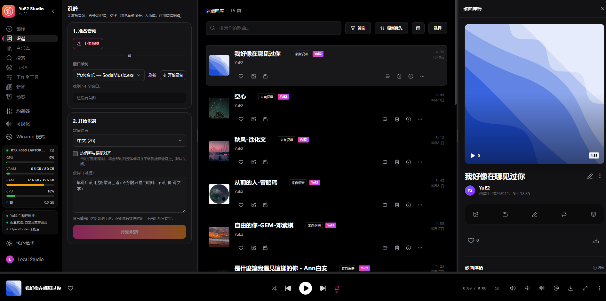

## 1. 准备音频

可以通过上传已有的音频（支持多种音频格式，包括常用的mp3），或者对音乐播放器的应用进行录音（比如：抖音、汽水音乐、QQ音乐、浏览器等等）。

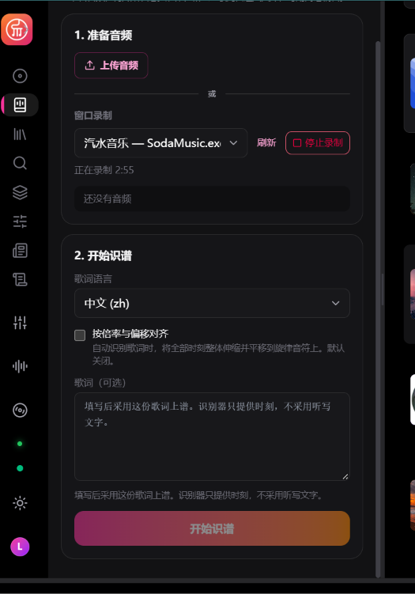

## 2. 开始识谱

根据歌词选择合适的语言，点击【开始识谱】按钮后自动开始识谱。

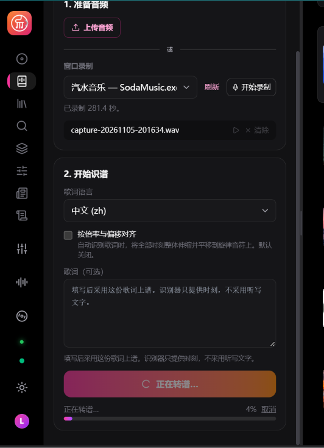

## 3. 矫正曲谱

### 3.1 修改曲谱名称

识谱完成后，会自动加入识谱曲库。在曲库中找到对应的曲谱，点击标题旁边的编辑图标，可以修改曲谱名称。

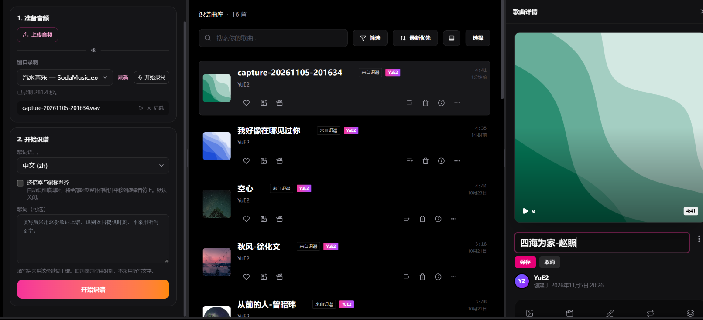

### 3.2 纠正歌词

自动识别的歌词如果不准确，你可以通过其他方式获得正确的歌词，比如：把音乐的分享链接丢给AI（DeepSeek，豆包都可以）获取歌词。

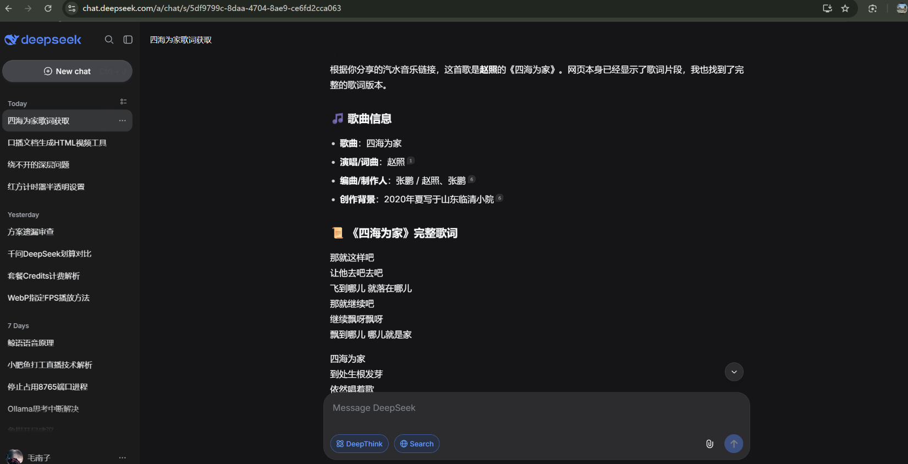

将获得的歌词粘贴到歌曲详情最下面的歌词栏中。

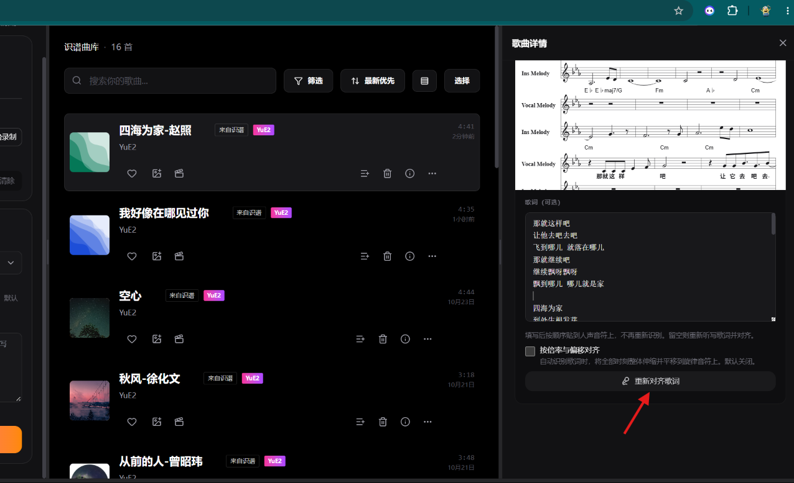

然后点击【重新对齐歌词】按钮。

### 3.3 编辑简谱

- 文本谱

文本谱提供了非常方便修改和曲谱、对齐歌词的功能。

当你在文本谱中移动光标时，简谱区的当前光标位置也会发生改变。

- 简谱渲染

简谱区让你能直观的看到简谱。
当你用鼠标点击简谱的音符或者歌词的时候，文本谱区的光标也会移动到对应的位置，这样就能很方便的看到简谱和文本谱的对应关系。

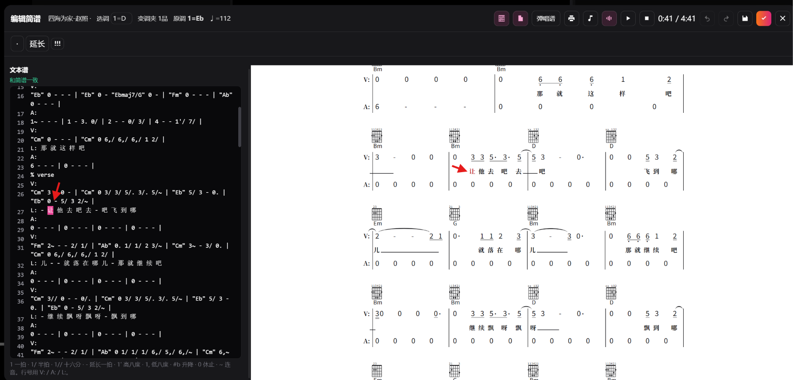

- 播放Midi

用MIDI的方式播放当前的曲谱。
在简谱区点击简谱的歌词或者音符，选择工具条“MIDI”图标，然后点击“播放”图标按钮，会软件从当前音符开始播放原MIDI。

工具条上的「唱谱」「伴奏谱」「和弦」三个按钮可以分别开关这三个声部在 MIDI 播放中的发声：

- **唱谱**：V: 行的人声旋律；
- **伴奏谱**：A: 行的伴奏；
- **和弦**：根据谱面上的和弦符号产生的和弦音。

按钮按下时该声部发声；再点一下，按钮变灰并加删除线，该声部在 MIDI 播放中静音。播放中切换立即生效，当前小节正在响的音会被切断，不会等到下一次播放。静音只影响 MIDI 播放，点击音符试听仍然有声音；播放原音频时这三个按钮不可用，因为原音频无法拆分声部。选择会记在本机，下次打开仍然有效。

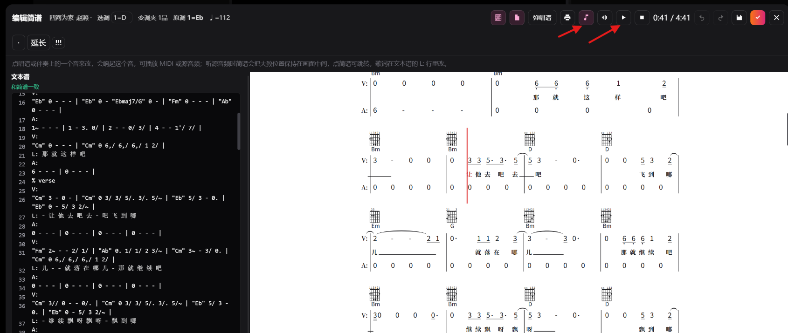

- 播放原音频

播放原始的音频。

在简谱区点击简谱的歌词或者音符，选择工具条“音频”图标，然后点击“播放”图标按钮，会软件会尝试从尝试匹配当前音符的位置开始播放原音频。

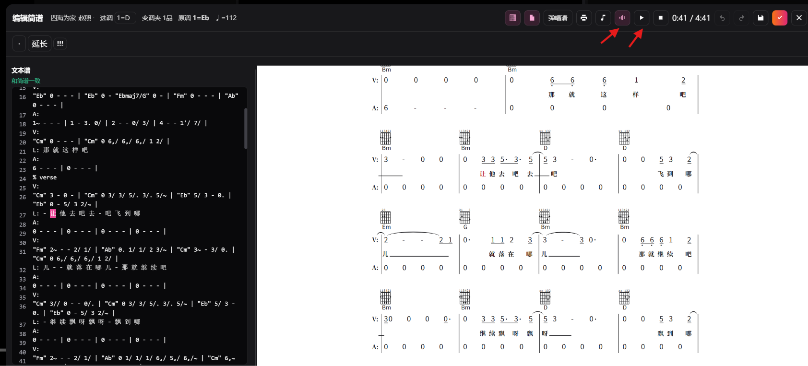

- 选调：

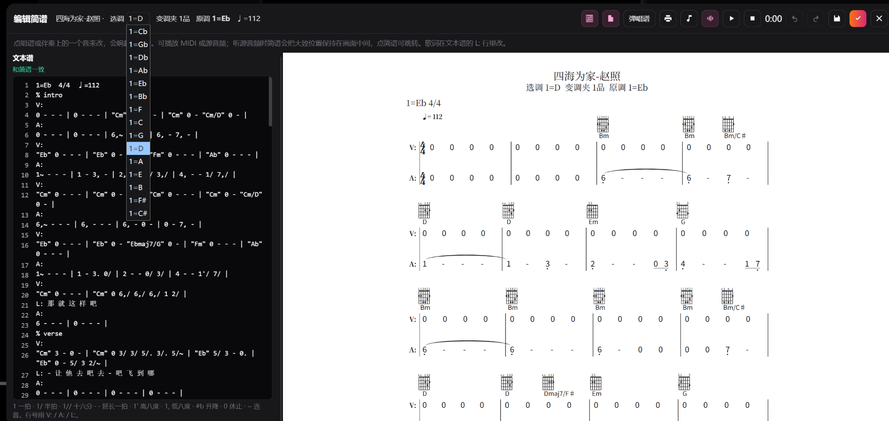

- 选和弦图：

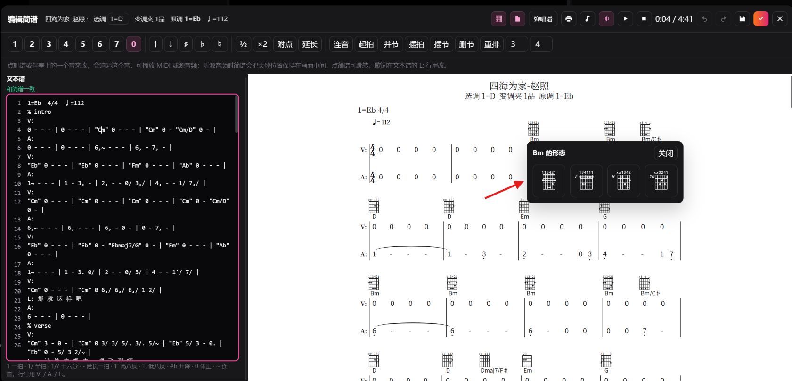

- 保持曲谱

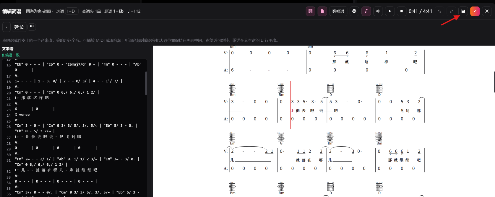

- 恢复操作

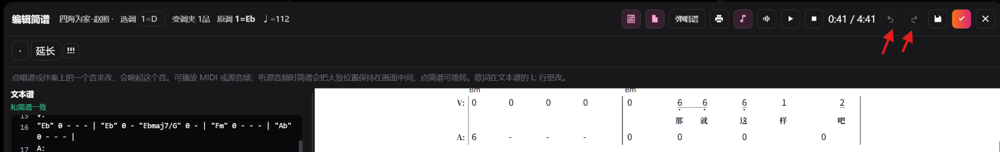

- 弹唱谱

点击工具条上的“弹唱谱”，可以显示只包括歌词的弹唱谱。

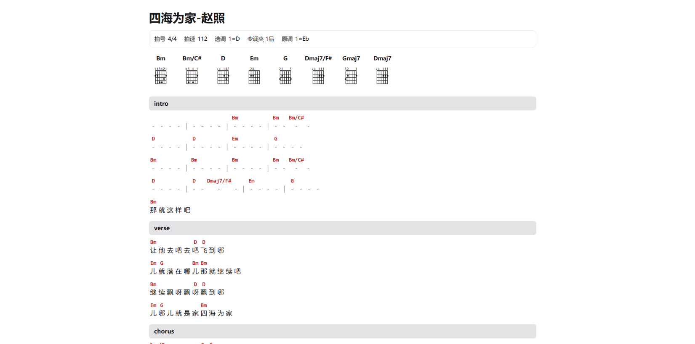

- 打印曲谱

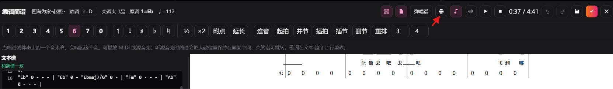

从工具栏选打印图标，就可以打印当前曲谱。

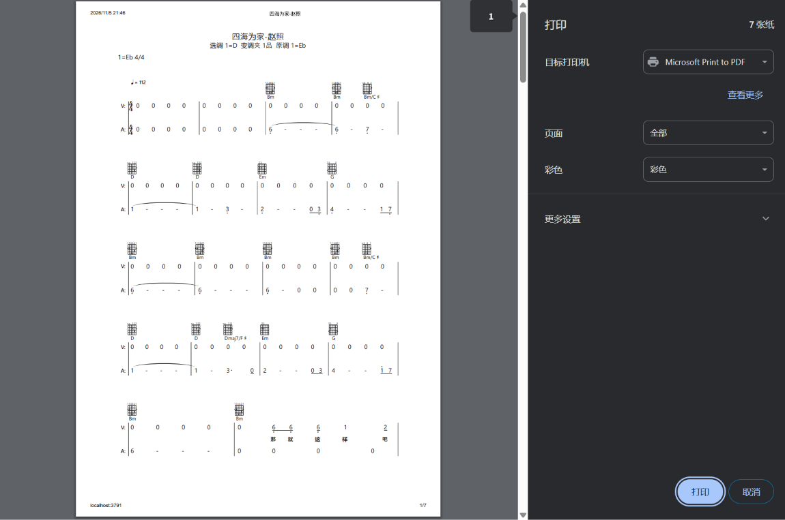
